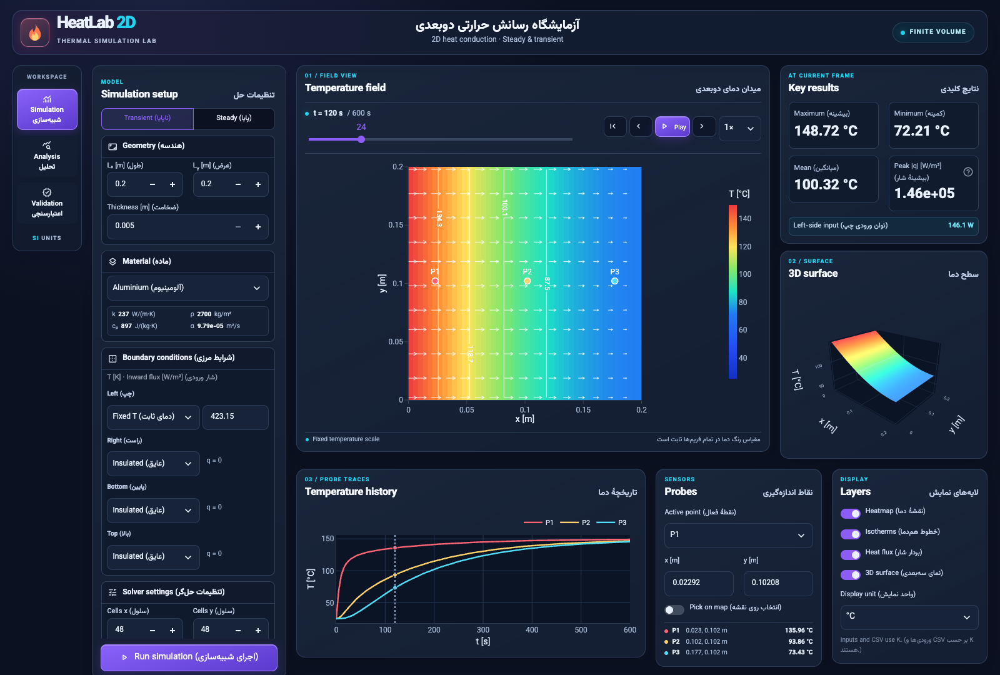

# HeatLab 2D

[English](#english) · [فارسی](#فارسی) · [Numerical model](docs/model.md) · [Release checklist](docs/RELEASE.md)

HeatLab 2D is a bilingual Streamlit workbench for steady and transient heat conduction in a rectangular solid. It combines a conservative finite-volume solver, interactive temperature and flux views, and reproducible scientific validation.



## English

### Run on a MacBook

Install [Python 3.14](https://www.python.org/downloads/macos/) and open Terminal in the repository or extracted project folder. Use the native Python build for your Mac.

```bash
python3.14 -m venv .venv
source .venv/bin/activate
python -m pip install -r requirements.txt
python -m streamlit run app.py
```

Open [http://localhost:8501](http://localhost:8501) if the browser does not open automatically. The app starts by solving the default aluminium example. Edit the geometry, material, boundary conditions and generation, then select **Run simulation**.

- **Simulation** displays the 2D field, isotherms, heat flux, 3D surface and three probe histories. The temperature scale stays fixed across the run.
- **Analysis** shows energy changes, compares steady and transient runs on the same model, and exports CSV, JSON, PNG and GIF. MP4 is enabled by installing `requirements-video.txt`.
- **Validation** runs analytical benchmarks, displays error and refinement studies, and produces a PDF with a matching CSV/PNG bundle. An optional appendix records the current model and its energy audit.

[Mobile dashboard screenshot](docs/images/dashboard-mobile.png)

### Numerical model

The solver advances $\rho c_p\,\partial T/\partial t = \nabla\cdot(k\nabla T)+\dot q$ with backward Euler. The steady solution sets the time derivative to zero. The cell-centred finite-volume operator accounts for slab thickness, the source term and independent Dirichlet, Neumann or Robin boundary conditions on the four sides.

The material is homogeneous and isotropic with constant properties. The through-thickness faces are adiabatic. The model covers conduction, time-independent boundary data and time-independent generation. A pure-flux steady problem requires compatible net power and a reference mean temperature. [Equations, signs and numerical details](docs/model.md)

```text
app.py  →  dashboard.py  →  solver.py
                │              └── geometry.py · materials.py · boundaries.py
                ├── plots.py · visualization.py · media.py
                └── scientific_validation.py · scientific_reporting.py
```

### Reproducible validation

| Case | Reference | Finest-level finding |
| --- | --- | --- |
| Generated steady slab | Exact parabolic temperature profile | Spatial order ≈ 2 |
| Insulated transient rectangle | Exact decaying 2D cosine mode | Time order ≈ 1 against the exact-in-time discrete solution |
| Mixed-boundary transient slab | Independent discrete energy audit | Conservative boundary, source and storage balance |

[Measured CSV and JSON results](examples/validation/) · [Convergence plot](examples/validation/convergence.png)

```bash
python -m pip install -r requirements-dev.txt -r requirements-video.txt
python -m pytest -q
python -m heatlab.scientific_reporting --output validation-report
```

[GitHub Actions](.github/workflows/ci.yml) runs the tests and generates a report on Ubuntu and Apple Silicon macOS with Python 3.14. For hosting, select `main`, `app.py` and Python 3.14 in Streamlit Community Cloud. [Deployment and troubleshooting](docs/RELEASE.md)

## فارسی

HeatLab 2D برای شبیه‌سازی رسانش حرارتی پایا و ناپایا در جسم مستطیلی ساخته شده است. می‌توانید جنس ماده، ابعاد و ضخامت، تولید حرارت و شرایط هر ضلع را جداگانه تنظیم کنید. داشبورد دما، شار، تغییر انرژی و خطای حل را از نتایج محاسبه‌شده نشان می‌دهد.

### نصب روی مک‌بوک

ابتدا [Python 3.14](https://www.python.org/downloads/macos/) را نصب کنید. در ترمینال به پوشهٔ پروژه بروید و اجرا کنید.

```bash
python3.14 -m venv .venv
source .venv/bin/activate
python -m pip install -r requirements.txt
python -m streamlit run app.py
```

در صورت نیاز، [نشانی محلی برنامه](http://localhost:8501) را در مرورگر باز کنید. برنامه ابتدا مسئلهٔ ناپایای آلومینیوم را حل می‌کند. بعد از تغییر ورودی‌ها، **Run simulation** را بزنید.

- **Simulation** برای میدان دما، خطوط هم‌دما، بردارهای شار، نمای سه‌بعدی و تاریخچهٔ دمای سه نقطه است.
- **Analysis** تغییر انرژی و مقایسهٔ حل پایا و ناپایا را نشان می‌دهد و فایل‌های CSV، JSON، PNG و GIF می‌سازد.
- **Validation** خطای حل را با جواب تحلیلی مقایسه و گزارش PDF و داده‌های همراه را تولید می‌کند. تنظیمات شبیه‌سازی فعلی هم می‌توانند در پیوست ثبت شوند.

حل‌گر از حجم محدودِ مرکز سلول، دستگاه تنک و اویلر پسرو استفاده می‌کند. خواص ماده ثابت‌اند و دما در راستای ضخامت یکنواخت فرض می‌شود. [راهنمای فارسی معادلات، معماری و اعتبارسنجی](docs/guide-fa.md)

برای اجرای آزمون‌ها، وابستگی‌های توسعه را نصب و `python -m pytest -q` را اجرا کنید. برای انتشار، در Streamlit Community Cloud شاخهٔ `main`، فایل `app.py` و Python 3.14 را انتخاب کنید. [راهنمای انتشار و رفع خطا](docs/RELEASE.md)
