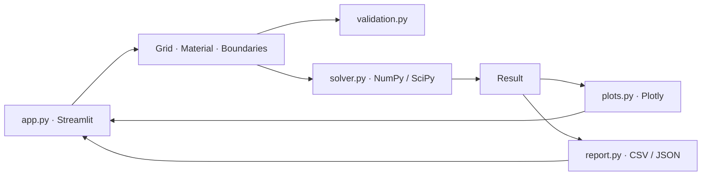

# HeatLab 2D

شبیه‌ساز رسانش حرارتی دوبعدی در جسم جامد مستطیلی، با حل پایا و ناپایا و رابط دوزبانهٔ فارسی و انگلیسی. ورودی‌ها، نمودارها و فایل‌های خروجی از واحدهای SI استفاده می‌کنند.

## معماری و ساختار فایل‌ها

```text
HeatLab2D/
├── app.py
├── requirements.txt
├── requirements-dev.txt
├── requirements-video.txt
├── .streamlit/config.toml
├── assets/
│   ├── dashboard.css
│   ├── Vazirmatn.woff2
│   ├── Vazirmatn-Regular.ttf
│   └── Vazirmatn-OFL.txt
├── README.md
├── .gitignore
├── heatlab/
│   ├── __init__.py
│   ├── geometry.py
│   ├── materials.py
│   ├── media.py
│   ├── boundaries.py
│   ├── dashboard.py
│   ├── validation.py
│   ├── solver.py
│   ├── plots.py
│   ├── report.py
│   ├── report_figures.py
│   ├── report_pdf.py
│   ├── scientific_reporting.py
│   ├── scientific_validation.py
│   ├── verification.py
│   └── visualization.py
└── tests/
    ├── test_solver.py
    ├── test_report.py
    ├── test_app.py
    ├── test_generation_and_flux.py
    ├── test_visualization.py
    └── test_scientific_reporting.py
```



| فایل | مسئولیت |
| --- | --- |
| `app.py` | تنظیم مدل، اجرای حل و مسیریابی میان سه بخش داشبورد |
| `heatlab/dashboard.py` | چیدمان نتیجه، پخش زمانی، نقاط اندازه‌گیری، خروجی و اعتبارسنجی |
| `assets/dashboard.css` | پوستهٔ تیره، فونت دوزبانه و چیدمان واکنش‌گرا |
| `heatlab/geometry.py` | شبکهٔ یکنواخت مستطیلی، مختصات مراکز سلول‌ها، سطح وجوه و حجم سلول |
| `heatlab/materials.py` | رسانندگی، چگالی و گرمای ویژهٔ ثابت |
| `heatlab/boundaries.py` | تعریف و اعتبارسنجی شرایط مستقل چهار ضلع |
| `heatlab/validation.py` | کنترل اعداد، حدود اندازه و طبقه‌بندی خطاهای ورودی و حل |
| `heatlab/solver.py` | حل تنک پایا و ناپایا، شار وجوه، توان عبوری و موازنهٔ انرژی |
| `heatlab/plots.py` | نقشهٔ دما، شار، سطح سه‌بعدی، تاریخچهٔ نقاط و نمودارهای تحلیل |
| `heatlab/visualization.py` | مقیاس ثابت، زمان‌بندی نمایش، انتگرال انرژی و مقایسهٔ دو رژیم |
| `heatlab/media.py` | ترسیم PNG، GIF و MP4 از میدان‌های حل‌شده |
| `heatlab/report.py` | خروجی CSV و JSON از داده‌های محاسبه‌شده |
| `heatlab/verification.py` | مطالعهٔ بازتولیدپذیر همگرایی مکانی، زمانی و موازنهٔ انرژی |
| `heatlab/scientific_validation.py` | سه شاخص خطا، مقایسهٔ ریزسازی‌های متوالی و ممیزی مستقل انرژی |
| `heatlab/scientific_reporting.py` | ساخت PDF، جدول‌های CSV، نمودارهای PNG و پروندهٔ JSON |
| `tests/` | مقایسه با جواب تحلیلی، آزمون موازنه، کنترل خروجی و آزمون رابط |

حل‌گر مستقل از Streamlit و Plotly است. رابط و ابزارهای خروجی از شیء `Result` مشترک استفاده می‌کنند.

## اجرا روی macOS

Python 3.14 را نصب کنید و از پوشهٔ حاوی `app.py` این فرمان‌ها را اجرا کنید.

```bash
python3.14 -m venv .venv
source .venv/bin/activate
python -m pip install -r requirements.txt
python -m streamlit run app.py
```

نشانی محلی را از ترمینال باز کنید. داشبورد در شروع یک مدل ناپایای آلومینیوم را حل می‌کند و میدان زمان ۱۲۰ ثانیه را نمایش می‌دهد. مقادیر مواد آماده، ورودی‌های نماینده با خواص ثابت هستند و گزینهٔ **Custom (سفارشی)** امکان وارد کردن خواص دلخواه را می‌دهد. پس از تغییر ورودی‌ها، **Run simulation (اجرای شبیه‌سازی)** را بزنید. روی صفحه‌های باریک، پیوند **Setup (تنظیمات)** به پنل ورودی‌ها می‌رود.

اجرای محلی و آزمون‌ها با Python 3.14.10 روی macOS با Apple Silicon بررسی شده‌اند. نسخه‌های وابستگی‌ها در `requirements.txt` مشخص شده‌اند.

## استفاده از داشبورد

- **Simulation (شبیه‌سازی)** نقشهٔ دوبعدی، مقادیر کلیدی، سطح سه‌بعدی و تاریخچهٔ نقاط را در یک تراز زمانی مشترک نشان می‌دهد. در حالت مکث، لغزنده و دکمه‌های تک‌گامی به همهٔ ترازهای ذخیره‌شده دسترسی دارند. حین پخش، نشانگر پیشرفت جای لغزنده را می‌گیرد. پخش خودکار با سرعت‌های ۰٫۵×، ۱×، ۲× و ۴× بر حسب زمان واقعی پیش می‌رود. پخش کامل از ابتدا در سرعت ۱× حدود ۱۸ ثانیه طول می‌کشد. در نمایش خودکار ممکن است بعضی از فریم‌ها رد شوند. حل‌گر همهٔ گام‌ها را محاسبه و ذخیره می‌کند و فایل‌های CSV از داده‌های کامل استفاده می‌کنند.
- **Probes (نقاط اندازه‌گیری)** سه نقطهٔ قابل تنظیم دارد. مختصات را وارد کنید یا پس از روشن کردن **Pick on map (انتخاب روی نقشه)** روی سلول نقشه کلیک کنید. نقطه به مرکز همان سلول می‌رود و منحنی دما از مقادیر حل‌شدهٔ آن سلول ساخته می‌شود.
- **Layers (لایه‌ها)** نقشهٔ دما، خطوط هم‌دما، بردارهای شار و سطح سه‌بعدی را جداگانه روشن و خاموش می‌کند. واحد نمایش °C یا K است. ورودی‌ها و CSV بر حسب K هستند. دامنهٔ رنگ و سطوح هم‌دما برای کل اجرا ثابت‌اند. بردارها از میانگین شار وجوه مجاور به دست می‌آیند. برای خوانایی، موقعیت و طول پیکان‌ها در هر فریم با نمونه‌برداری مکانی و مقیاس ریشهٔ دوم نمایش داده می‌شوند. CSV شار مقادیر دقیق وجوه را نگه می‌دارد.
- **Analysis → Energy** انرژی محسوس ذخیره‌شده و تغییر آن را همراه با انرژی ورودیِ تجمعی از مرز و تولید حجمی نشان می‌دهد. ورودی مرزی با نرخ انتهای هر گام انتگرال‌گیری می‌شود و باقیمانده در واحد ژول گزارش می‌شود.
- **Analysis → Compare** حالت دوم را روی همان شبکه، ماده، شرایط مرزی و میدان تولید حل می‌کند. دو نقشه مقیاس رنگ مشترک دارند. نقشهٔ اختلاف `T_transient − T_steady` و نمودار RMS و بیشینهٔ قدرمطلق اختلاف نیز نمایش داده می‌شوند. در حالت پایای شارمحور سازگار، مرجع میانگین همان میانگین میدان اولیهٔ حل ناپایاست.
- **Validation (اعتبارسنجی)** موازنهٔ حل فعلی را گزارش می‌کند و مسائل مرجع همگرایی را با همان حل‌گر اجرا می‌کند. خطای بیشینه بر حسب اندازهٔ شبکه و گام زمانی در نمودارهای لگاریتمی نمایش داده می‌شود.

### خروجی تصویر و ویدیو

در **Analysis → Export** می‌توان CSV میدان، شار، تاریخچه، نقاط و انرژی را دریافت کرد. گزینهٔ **Prepare PNG** نقشهٔ تراز منتخب را همراه با لایه‌های فعال می‌سازد. دکمهٔ دوربین در نوار ابزار Plotly برای سایر نمودارها نیز خروجی PNG دارد. GIF و MP4 تا ۳۰ فریم از ترازهای حل‌شده، شامل ابتدا و انتهای حل، انتخاب می‌کنند. تعداد فریم و سرعت فایل قابل تنظیم است.

PNG و GIF با Matplotlib و Pillow در محیط سرور ترسیم می‌شوند. برای فعال‌کردن گزینهٔ MP4 نصب وابستگی اختیاری لازم است. [مستندات Matplotlib](https://matplotlib.org/stable/gallery/misc/agg_buffer.html) · [مستندات imageio-ffmpeg](https://github.com/imageio/imageio-ffmpeg)

```bash
python -m pip install -r requirements-video.txt
```

فونت Vazirmatn به‌صورت محلی همراه پروژه ارائه شده است. [منبع فونت و مجوز](https://github.com/rastikerdar/vazirmatn)

## مدل فیزیکی

معادلهٔ رسانش برای مادهٔ همگن و همسانگرد با خواص ثابت است.

```text
Steady      ∇·(k ∇T) + q̇ = 0
Transient   ρ cₚ ∂T/∂t = ∇·(k ∇T) + q̇
```

تولید گرمای حجمی در زمان ثابت است و در هر سلول می‌تواند مقدار متفاوتی داشته باشد. مقدار مثبت گرما می‌افزاید و مقدار منفی گرما می‌گیرد. دما در راستای ضخامت یکنواخت و دو وجه عمود بر راستای ضخامت عایق فرض می‌شوند. ضخامت در محاسبهٔ مساحت، حجم، توان گرمایی و ظرفیت حرارتی به کار می‌رود.

| کمیت | واحد |
| --- | --- |
| ابعاد، ضخامت، مختصات | m |
| دمای سطح، محیط، اولیه و مرجع | K |
| رسانندگی حرارتی k | W/(m·K) |
| چگالی ρ | kg/m³ |
| گرمای ویژه cₚ | J/(kg·K) |
| شار ورودی q | W/m² |
| تولید حجمی q̇ | W/m³ |
| ضریب همرفت h | W/(m²·K) |
| زمان | s |
| توان ورودی و نرخ انباشت انرژی | W |
| انرژی محسوس ذخیره‌شده | J |

محور x از چپ به راست و y از پایین به بالا افزایش می‌یابد. هر ضلع در تمام طول خود و در کل زمان حل یک شرط ثابت دارد. رابط برای تولید حجمی و دمای اولیه یک مقدار یکنواخت می‌گیرد. API برای هر دو ورودی مقدار یکنواخت یا آرایهٔ `(ny, nx)` می‌پذیرد.

| شرط | رابطه با جهت مثبت رو به داخل جسم |
| --- | --- |
| دمای ثابت (Dirichlet) | دمای سطح برابر مقدار تجویزی است. |
| شار تجویزی (Neumann) | توان ورودی هر وجه برابر qA است. شار منفی گرما را از جسم خارج می‌کند. |
| عایق | شار ورودی صفر است. |
| همرفت (Robin) | شار ورودی سطح برابر h(T∞ − Tsurface) است. |

در حل پایای شارمحور، مجموع توان ورودی اضلاع و توان تولیدی سلول‌ها باید صفر باشد. آستانهٔ بررسی `1e-12` ضربدر مجموع قدرمطلق این سهم‌هاست. اگر شرط برقرار نباشد، حل‌گر `IncompatibleSteadyError` می‌دهد. اگر بار سازگار باشد و دمای میانگین مرجع داده نشده باشد، `NonUniqueSteadyError` می‌دهد. با داشتن مرجع، ابتدا دمای یک سلول موقتاً تثبیت می‌شود و سپس کل میدان جابه‌جا می‌شود تا میانگین خواسته‌شده به دست آید. در حل ناپایا، ظرفیت حرارتی و میدان اولیه امکان حل با توان خالص غیرصفر را فراهم می‌کنند.

## گسسته‌سازی

مجهول‌ها دمای مرکز سلول هستند. در حجم محدود، رسانایی بین دو مرکز همسایه `kA/Δ` است. برای دمای ثابت سطح، فاصلهٔ مرکز تا وجه `Δ/2` است و رسانایی `2kA/Δ` می‌شود. برای همرفت، رسانایی وجه `A / (Δ/(2k) + 1/h)` است که مقاومت رسانش نیم‌سلول و همرفت را سری می‌کند. سلول گوشه‌ای سهم دو وجه مستقل را می‌گیرد.

```text
Steady       K θ = b
Transient    (K + C/Δt I) Δθ = b − K θold
             θnew = θold + Δθ
             C = ρ cₚ Vcell
```

`θ` دما نسبت به یک جابه‌جایی ثابت داخلی است. سمت راست برای هر سلول شامل سهم مرزها و `q̇ Vcell` است. سهم شار یک وجه داخلی در دو سلول همسایه برابر و با علامت مخالف است. حل‌گر از تجزیهٔ LU تنک در SciPy استفاده می‌کند. در اویلر پسرو، شار مرزی و رسانش در انتهای گام ارزیابی می‌شوند و تجزیهٔ ماتریس یک بار برای همهٔ گام‌ها انجام می‌شود. [مستندات SciPy](https://docs.scipy.org/doc/scipy/reference/generated/scipy.sparse.linalg.splu.html)

شار فوریه روی وجوه داخلی با `−k (Tneighbor − Tcell)/Δ` در جهت افزایشی محور محاسبه می‌شود. شار ورودی مرزی در چپ و پایین هم‌جهت با محور و در راست و بالا خلاف جهت محور است. نرخ عبوری از هر مقطع با ضرب شار هر وجه در مساحت و جمع روی مقطع به دست می‌آید.

انرژی محسوس نسبت به مرجع صفر کلوین برابر `E = Σ ρ cₚ Vcell Tcell` است. نرخ انباشت ناپایا از `(Enew − Eold)/Δt` به دست می‌آید. حل‌گر برای کاهش خطای گرد کردن این اختلاف را از تغییر دمای هر سلول محاسبه می‌کند. باقیماندهٔ موازنه برابر توان ورودی مرزی به‌علاوهٔ توان تولیدی منهای نرخ انباشت است. در حالت پایا نرخ انباشت صفر است.

## API پایتون

این مثال ورودی را تعریف می‌کند و سپس نتیجه را با حل‌گر محاسبه می‌کند.

```python
import numpy as np

from heatlab.boundaries import Boundaries, Boundary, Kind
from heatlab.geometry import Grid
from heatlab.materials import Material
from heatlab.solver import solve_steady, solve_transient

grid = Grid(width_m=0.20, height_m=0.10, thickness_m=0.01, nx=40, ny=20)
material = Material(conductivity_w_mk=15.0, density_kg_m3=7800.0,
                    specific_heat_j_kgk=500.0)
insulated = Boundary(Kind.INSULATED)
boundaries = Boundaries(
    left=Boundary(Kind.TEMPERATURE, 350.0),
    right=Boundary(Kind.CONVECTION, 300.0, h_w_m2k=20.0),
    bottom=insulated,
    top=insulated,
)

initial_k = 300 + 10 * np.outer(np.cos(np.pi * grid.y_m / grid.height_m),
                               np.cos(np.pi * grid.x_m / grid.width_m))
steady = solve_steady(grid, material, boundaries, generation_w_m3=6000)
transient = solve_transient(grid, material, boundaries, initial_k=initial_k,
                            duration_s=600.0, steps=120, generation_w_m3=6000)
flux = transient.face_flux(-1)
print(steady.balance_w[0])
print(flux.x_rate_w[-1], flux.y_rate_w[-1])
print(transient.stored_energy_j[-1] - transient.stored_energy_j[0])
```

آرایهٔ `temperature_k` به شکل `[snapshot, y, x]` است. در حل پایا تنها یک میدان وجود دارد. در حل ناپایا `times_s[0] = 0` و میدان اولیه در همان اندیس ذخیره می‌شود. ترتیب ستون‌های `inward_w` چپ، راست، پایین و بالا است. `generated_w` توان تولیدی کل جسم و `stored_energy_j` انرژی هر تراز است. خروجی `face_flux` شامل `qx_w_m2` به شکل `(ny, nx + 1)` و `qy_w_m2` به شکل `(ny + 1, nx)` است. مختصات وجوه با `grid.x_faces_m` و `grid.y_faces_m` و توان مقاطع با `x_rate_w` و `y_rate_w` در دسترس‌اند.

حد هسته ۴۰٬۰۰۰ سلول و ۱۰٬۰۰۰ گام است. سقف ذخیرهٔ دما در حالت ناپایا `nx × ny × (steps + 1) ≤ 5,000,000` است. رابط به حداکثر ۱۰۰ سلول در هر راستا و ۲٬۰۰۰ گام محدود است.

## گزارش و خروجی‌ها

- CSV میدان منتخب شامل x، y و دمای مرکز هر سلول است.
- CSV شار شامل محور، مختصات، شار و توان علامت‌دارِ تک‌تک وجوه است.
- JSON گزارش شامل ورودی‌ها، روش حل، مشخصات میدان منتخب، توان هر ضلع، تولید حجمی، انرژی ذخیره‌شده و باقیماندهٔ موازنه است. در حل ناپایا، تنظیمات زمانی و میدان اولیه نیز ثبت می‌شوند.
- CSV تاریخچهٔ ناپایا دماهای کمینه، میانگین و بیشینه، توان اضلاع، توان خالص، توان تولیدی، انرژی ذخیره‌شده، نرخ انباشت و باقیمانده را ثبت می‌کند. نرخ انباشت و باقیمانده در زمان صفر خالی است.

## آزمون و مطالعهٔ همگرایی

```bash
python -m pip install -r requirements-dev.txt
python -m pytest -q
python -m heatlab.verification
```

آزمون‌ها پروفیل خطی، جواب مقاومت سری همرفت، میدان شار متوازن، جواب سری فوریهٔ پایای دوبعدی، افت زمانی مُد دوبعدی، شرط‌های ترکیبی یک سلول و حل تحلیلی دستگاه دوسلولی با تولید غیریکنواخت را بررسی می‌کنند. آزمون‌های شار و انرژی، علامت‌ها و موازنهٔ سلولی و سراسری را کنترل می‌کنند. [مستندات pytest](https://docs.pytest.org/en/stable/)

در مطالعهٔ مکانی، جواب مرجع ورق با تولید یکنواخت و دمای ثابت روی دو ضلع روبه‌رو `T(x) = Ts + q̇ x(L − x)/(2k)` است. هر دو اندازهٔ سلول نصف می‌شوند و بیشینهٔ خطای دما در مراکز سلول اندازه‌گیری می‌شود. در مطالعهٔ زمانی، شبکه ثابت است و جواب مرجع مُد کسینوسی دوبعدی با مقدار ویژهٔ گسستهٔ شبکه به‌طور دقیق در زمان محاسبه می‌شود. این انتخاب خطای زمانی را جدا از خطای مکانی اندازه می‌گیرد. مرتبهٔ مشاهده‌شده از `log₂(error_coarse/error_fine)` به دست می‌آید.

در مطالعهٔ موازنهٔ ناپایا، توان‌های انتهای گام مطابق اویلر پسرو انتگرال‌گیری و با تغییر انرژی ذخیره‌شده مقایسه می‌شوند. باقیماندهٔ موازنه پایستگی را می‌سنجد. دقت دما با مقایسهٔ تحلیلی و ریزسازی سنجیده می‌شود.

### گزارش علمی و اعتبارسنجی تفصیلی

در **Validation** ابتدا **Run benchmarks** و سپس **Prepare PDF and data** را بزنید. گزینهٔ پیوست، فرضیات و داده‌های شبیه‌سازی فعلی و ممیزی انرژی آن را در صفحه‌ای جدا ثبت می‌کند. مقایسه‌های تحلیلی گزارش متعلق به مدل‌های مرجع تعریف‌شده هستند.

```bash
python -m heatlab.scientific_reporting --output validation-report
```

- مسئلهٔ پایا، حل دیوارهٔ تخت با تولید یکنواخت را روی چهار شبکه با جواب تحلیلی مقایسه می‌کند. مسئلهٔ ناپایا، مُد کسینوسی دوبعدی با مرزهای عایق را با هفت گام زمانی روی شبکهٔ ثابت اجرا می‌کند. جدول زمان هم خطای نسبت به جواب دقیق زمانیِ مدل نیمه‌گسسته و هم خطای نسبت به جواب تحلیلی پیوسته را ثبت می‌کند.
- **MAE، RMSE و بیشینهٔ قدرمطلق خطا** از دماهای هم‌مکان در مراکز سلول‌ها محاسبه می‌شوند. برای مقایسهٔ دو شبکهٔ متوالی، میدان ریز با درون‌یابی دوجهته در مراکز شبکهٔ درشت ارزیابی می‌شود. برای آزمون زمانی، میدان‌ها در یک زمان نهایی و روی همان شبکه مقایسه می‌شوند. آستانهٔ (0.01) K صرفاً معیار پذیرش این مطالعه است.
- در ممیزی مستقل، توان ورودی اضلاع و تولید حجمی با تغییر انرژی ذخیره‌شده مقایسه می‌شوند. آستانه‌های مطالعه (10^{-8}) W برای باقیماندهٔ توان و (10^{-8}) J برای باقیماندهٔ انرژی تجمعی‌اند.
- PDF بدنهٔ علمی انگلیسی و چکیدهٔ فارسی دارد. بستهٔ داده شامل پنج CSV، چهار PNG و `validation.json` با فرضیات، ورودی‌ها، تنظیمات حل‌گر، نسخهٔ وابستگی‌ها و نتایج اندازه‌گیری‌شده است. فصل‌ها و بخش‌های مرجع از ویرایش هشتم کتاب Bergman، Lavine، Incropera و DeWitt در گزارش ثبت شده‌اند. [فهرست رسمی Wiley](https://catalogimages.wiley.com/images/db/pdf/9781119320432.toc.pdf)

## انتشار روی وب

پوشهٔ پروژه را در یک مخزن GitHub قرار دهید و `app.py` را به‌عنوان فایل ورودی در Streamlit Community Cloud انتخاب کنید. `requirements.txt` را کنار آن نگه دارید. برای استفاده از همان نسخهٔ پایتون، در **Advanced settings** نسخهٔ 3.14 را انتخاب کنید. [راهنمای انتشار Streamlit](https://docs.streamlit.io/deploy/streamlit-community-cloud/deploy-your-app/deploy) · [راهنمای وابستگی‌ها](https://docs.streamlit.io/deploy/streamlit-community-cloud/deploy-your-app/app-dependencies)
